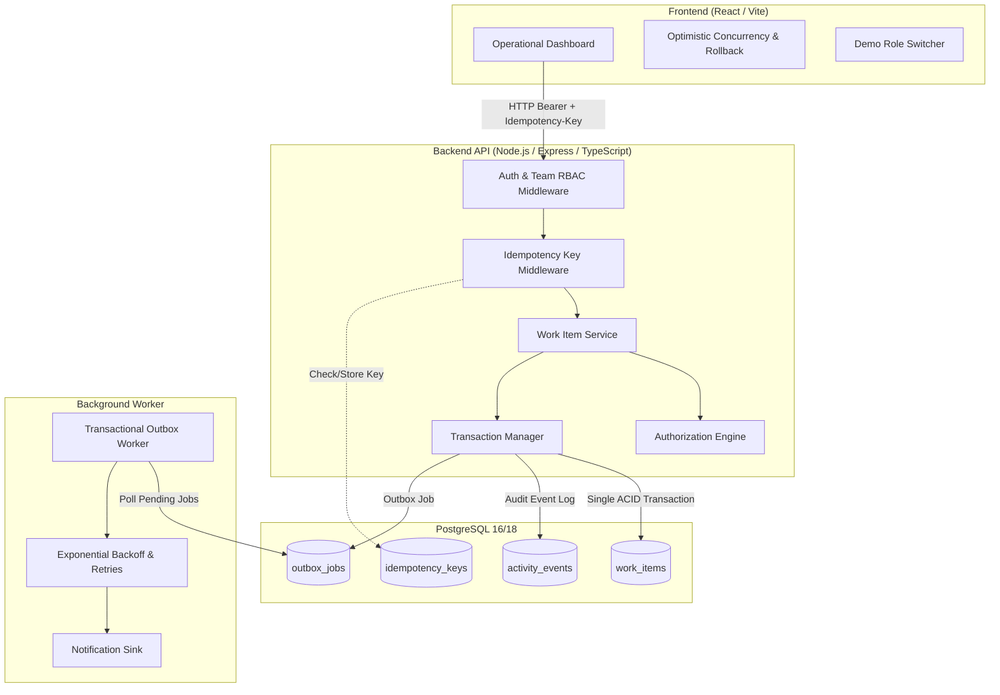

# Newtonite — Operations Under Pressure

An internal operations management platform designed for cross-team ticket creation, atomic assignment, strict state transitions, and audit logging under high concurrency. Built with focus on database-level concurrency control, optimistic locking, idempotent execution, and team-scoped authorization.

---

## Architecture Diagram



---

## Critical Behaviours Implemented

| Critical Behaviour | Implementation Mechanism | Test Verification |
| :--- | :--- | :--- |
| **1. Concurrent Item Claim** | Atomic conditional update: `UPDATE work_items SET assigneeId = :userId WHERE id = :id AND assigneeId IS NULL;` 0 rows updated &rarr; `409 Conflict`. | Two claims fired simultaneously in parallel; exactly one succeeds, one receives 409. |
| **2. Optimistic Locking (Stale Edits)** | Client submits `version`. Server updates only `WHERE version = :clientVersion`, then increments. Version mismatch &rarr; `409 Conflict` returning latest state. | Update with stale version is rejected and existing data remains unaltered. |
| **3. Request Idempotency** | Client sends `Idempotency-Key` header. Middleware caches response in `idempotency_keys` table and replays with `X-Idempotent-Replay: true`. | Same key sent twice creates only one item and returns identical response. |
| **4. Strict Workflow State Machine** | Server-enforced transition map: `Open` &rarr; `In_Progress` &rarr; `Awaiting_Approval` &rarr; `Resolved` &rarr; `Closed`. Approval transition requires `Lead` or `Admin` role. | Invalid jump (`Open` &rarr; `Closed`) and non-Lead approval attempts are both rejected. |
| **5. Resource-Level Authorization** | Every query and mutation scoped to user's team membership via centralized `AuthorizationService`. | Users outside team receive `403 Forbidden` on read and write attempts. Viewers cannot mutate tickets. |
| **6. Transactional Outbox** | Background job enqueued within the same database transaction. Worker polls with retry limits, exponential backoff, and idempotent deduplication keys. | Job processed twice produces only one notification; failing job retries and marks failed after max attempts. |
| **7. Immutable Audit Trail** | Every state, assignee, or priority change writes an `activity_events` record within the exact same database transaction. | History and work item state never disagree. |

---

## Prerequisites

* **Docker & Docker Compose** (for single-command containerized run)  
  *OR*
* **Node.js 20+** and **PostgreSQL 14+** (for manual local execution)

---

## Exact Run Commands

### Option A: One-Command Docker Compose (Recommended for Reviewers)

```bash
# 1. Clone repository
git clone https://github.com/ABHINAVSINGHCODIE/NEWTONITE-SE.git
cd NEWTONITE-SE

# 2. Build and start containers (Postgres, Server API, and React Client)
docker compose up --build
```
* The React Dashboard will be live at: **http://localhost:3000**
* The Backend REST API will be live at: **http://localhost:4000**

---

### Option B: Local Development Execution

```bash
# 1. Install dependencies
cd server && npm install
cd ../client && npm install
cd ..

# 2. Set environment variables
cp .env.example server/.env
# Update DATABASE_URL in server/.env with your local PostgreSQL credentials

# 3. Apply Prisma migrations and generate client
npm --prefix server run prisma:push

# 4. Seed the database (creates 4 teams, 11 users, and 1,200 work items)
npm --prefix server run seed

# 5. Start Backend API & Outbox Worker (Port 4000)
npm run dev:server

# 6. In a second terminal, start Frontend Client (Port 3000)
npm run dev:client
```

---

## Demo Login Credentials per Role

All seed users are configured with the demo password: `Password123!`

The frontend also includes a **top-bar quick user switcher dropdown** that allows reviewers to switch between roles with a single click:

| Role | Name | Email | Accessible Teams |
| :--- | :--- | :--- | :--- |
| **Admin** | Alice Admin | `admin@newtonite.internal` | All Teams (`Core Platform`, `Payments`, `Trust`, `Compliance`) |
| **Lead** | Liam Lead | `lead.platform@newtonite.internal` | `Core Platform` (Can approve tickets awaiting approval) |
| **Member** | Maya Member | `member.platform@newtonite.internal` | `Core Platform` (Can create, edit, transition, and claim tickets) |
| **Viewer** | Victor Viewer | `viewer.platform@newtonite.internal` | `Core Platform` (Read-only access, cannot claim or edit) |
| **Lead (Payments)** | Penny Lead | `lead.payments@newtonite.internal` | `Payments & Billing` |
| **Member (Payments)**| Peter Member | `member.payments@newtonite.internal` | `Payments & Billing` |
| **Lead (Trust)** | Travis Lead | `lead.trust@newtonite.internal` | `Trust & Safety` |
| **Outsider** | Oscar Outsider | `outsider@newtonite.internal` | No team memberships (Used to verify 403 Forbidden behavior) |

---

## Running Automated Tests

All critical concurrency, idempotency, RBAC, and workflow tests pass with one single command:

```bash
npm test
```
*Or directly within the server directory:*
```bash
cd server && npm test
```

### Automated Test Suite Coverage:
* `Critical Behaviour 1`: Concurrent claim race condition &mdash; exactly one succeeds (409 Conflict for loser)
* `Critical Behaviour 2`: Stale edit rejection &mdash; version mismatch returns 409 with latest data
* `Critical Behaviour 3`: Idempotency Key header &mdash; duplicate submission returns cached response
* `Critical Behaviour 4`: Workflow transition validation & Lead-only approval guard
* `Critical Behaviour 5`: Scoped team authorization &mdash; outsider rejected with 403 on read and write
* `Critical Behaviour 6`: Transactional Outbox &mdash; deduplication and retry with max-attempt failure
* `Critical Behaviour 7`: Audit trail guarantees activity log matches work item transitions

---

## Known Limitations

1. **Transactional Outbox Polling:** Background worker polls every 2–3s. In high-throughput production, replacing polling with PostgreSQL `LISTEN/NOTIFY` or Change Data Capture (Debezium/Kafka) would achieve sub-millisecond dispatch.
2. **Idempotency Key Eviction:** Stored idempotency keys currently persist indefinitely. A production deployment would include an automatic 24-hour expiration TTL index.
3. **Soft Deletion:** Items and comments are currently not soft-deleted to ensure the audit log remains immutable.

---

## Next Week I Would...

* **PostgreSQL Full-Text Search Vector (`tsvector`):** Replace basic `LIKE / ILIKE` substring search with GIN-indexed Postgres `tsvector` columns for full phonetic and stemmed search across millions of ticket logs.
* **Bulk State Transitions:** Allow team leads to batch-approve multiple work items within a single transactional batch query.
* **SLA Breach Warnings:** Add automated background calculations flagging tickets approaching target SLA resolution times.